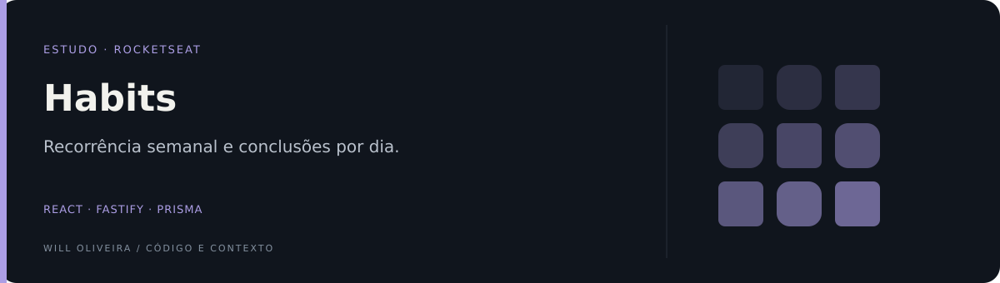

<p align="center">
  
</p>

# Habits · acompanhamento de hábitos

Aplicação de estudo para cadastrar hábitos, definir dias da semana e acompanhar conclusões diárias. Desenvolvida no contexto do NLW da Rocketseat.

**React · TypeScript · Tailwind CSS · Fastify · Prisma · SQLite**

## Explore o diferencial

| Ponto de entrada | O que observar |
| --- | --- |
| [Regra de recorrência](setup/aulas/server/src/routes.ts) | As rotas selecionam os hábitos de uma data e alternam sua conclusão. |
| [Modelagem do hábito](setup/aulas/server/prisma/schema.prisma) | O schema relaciona recorrência, dias e marcações de conclusão. |

## Destaques

- Cadastro de hábitos com dias da semana.
- Consulta dos hábitos possíveis e concluídos em uma data.
- Marcação e desmarcação de conclusão.
- Resumo diário para visualização de progresso.

<details>
<summary><strong>Organização e código</strong></summary>

### Organização e arquitetura

| Pasta | Responsabilidade |
| --- | --- |
| [setup/aulas/web](setup/aulas/web) | Interface React, componentes e consumo da API |
| [setup/aulas/server/src/routes.ts](setup/aulas/server/src/routes.ts) | Rotas e regras de cadastro, conclusão e resumo |
| [setup/aulas/server/prisma/schema.prisma](setup/aulas/server/prisma/schema.prisma) | Hábitos, recorrência semanal, dias e conclusões |

Os registros relacionam hábito e dia. A combinação é única, permitindo alternar a conclusão sem criar duas marcações para a mesma data.

</details>

<details>
<summary><strong>Executar e consultar</strong></summary>

### Executar localmente

Requer Node.js, npm e configuração do banco SQLite.

### API

```bash
cd setup/aulas/server
npm install
```

Configure `DATABASE_URL="file:./dev.db"` em `.env` nessa pasta. Depois:

```bash
npx prisma generate
npx prisma migrate dev
npm run dev
```

### Interface

Em outro terminal:

```bash
cd setup/aulas/web
npm install
npm run dev
```

Confira o endereço da API em `setup/aulas/web/src/lib/axios.ts` e abra o endereço indicado pelo Vite.

### Rotas para explorar

| Método | Rota | Função |
| --- | --- | --- |
| POST | `/habits` | Cadastrar hábito |
| GET | `/day?date=...` | Consultar uma data |
| PATCH | `/habits/:id/toggle` | Alternar conclusão no dia atual |
| GET | `/summary` | Resumo de progresso |

</details>

<details>
<summary>Escopo e referências</summary>

Projeto educacional sem autenticação, isolamento entre usuários ou suíte automatizada de testes versionada. Datas, tratamento de falhas e regras de recorrência são bons pontos para aprofundar antes de uso real.

</details>

---

Mantido por **Will Oliveira** · [Perfil](https://github.com/Will-Ifes) · [LinkedIn](https://www.linkedin.com/in/wildemberg-de-jesus-oliveira/)
